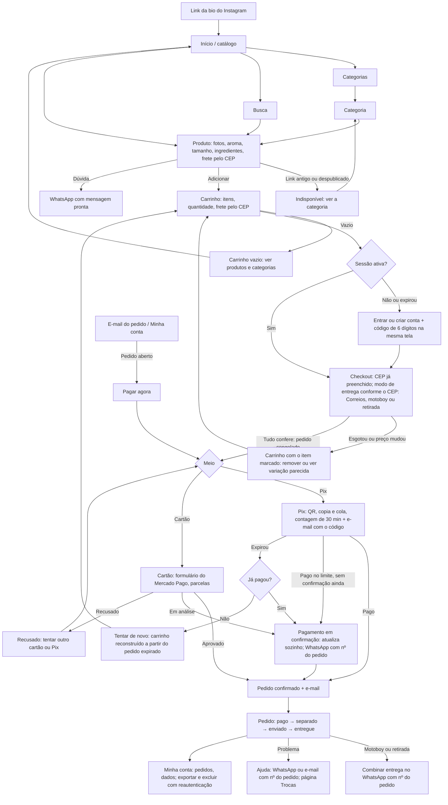
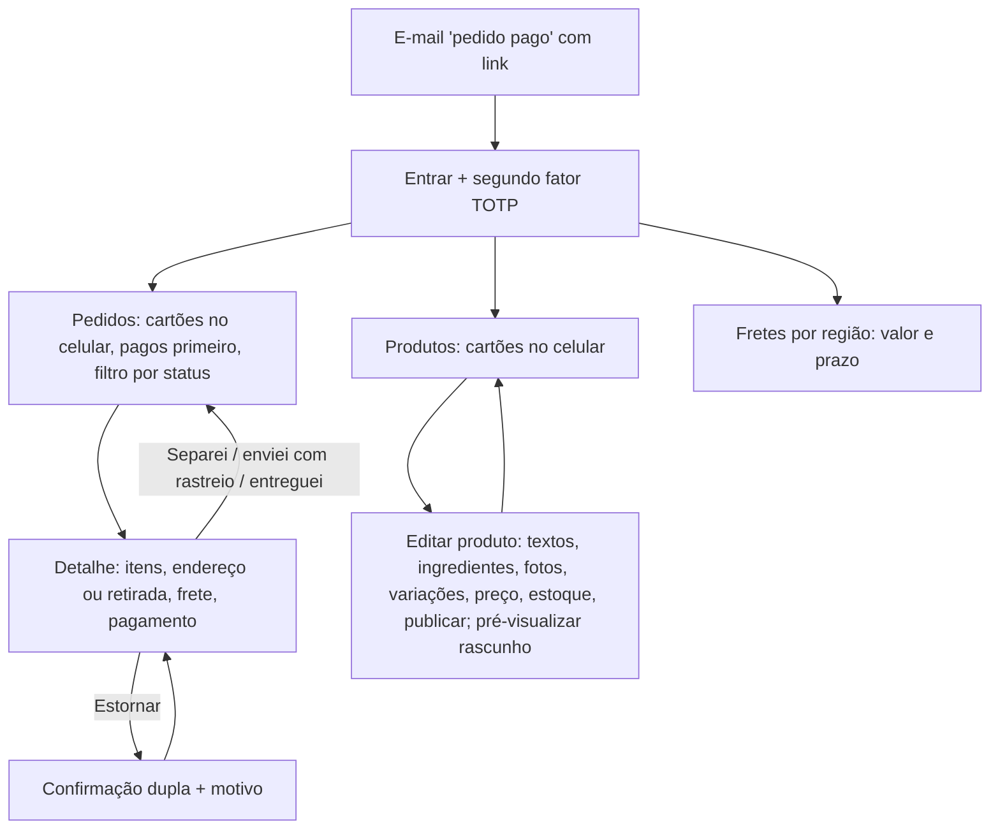

# Fidelidade — loja-online

As três fases de desenho do produto (15 §12). Cada fase só começa com a anterior aprovada. A IA desenha; os subagentes da skill `analise` conferem; o dono revisa antes de enviar ao cliente. **Cliente fictício:** o Pedro aprova no papel de cliente.

**Meio da alta fidelidade:** **só código**, decidido pelo Pedro em 26-Out (pedido de mudança nº 1; 15 §12.1, regra 5). A média fidelidade vai como wireframe em HTML na prévia.

## 1. Baixa fidelidade — com a proposta (Antes 2) — 2026-10-26 (versão 2, depois da conferência)

**O que vai:** as jornadas de cada perfil, o mapa de telas com a navegação e o mapa de acesso. A versão 1 foi conferida pelos subagentes `analista-ux-ui` e `analista-seguranca`, que devolveram "ajustar antes". Esta versão 2 incorpora todos os achados (tabela da conferência no fim desta seção).

### Jornadas

**Comprador** (visitante → comprador)

**Dona** (admin)

### Mapa de telas
| # | Tela | Rota | Perfis | Chega de | Vai para |
|---|---|---|---|---|---|
| 1 | Início / catálogo | `/` | todos | Instagram, cabeçalho, carrinho vazio, 404 | 2, 3, 4 |
| 2 | Categorias e categoria | `/categorias`, `/categoria/[slug]` | todos | 1, cabeçalho, produto indisponível | 4 |
| 3 | Busca | `/busca?q=` | todos | cabeçalho | 4 |
| 4 | Produto (estados: normal, esgotado, **indisponível ou despublicado**) | `/produto/[slug]` | todos | 1, 2, 3, posts antigos | 5, 2, WhatsApp |
| 5 | Carrinho (estados: com itens, **vazio**, **item esgotado ou com preço mudado**) | `/carrinho` | todos | 4, cabeçalho, 6 (falha), retry do Pix expirado | 9 ou 6; 1 e 2 se vazio |
| 6 | Checkout (CEP já preenchido, modo de entrega, endereço; na retirada, sem endereço) | `/checkout` | comprador | 5, 9 | 7, ou 5 se algo mudou |
| 7 | Pagamento (Pix ou cartão; estados: aguardando, **em confirmação**, recusado, expirado com "já pagou?") | `/checkout/pagamento/[pedido]` | comprador dono do pedido **aberto** | 6, **e-mail do pedido, 8 e 10 ("Pagar agora")** | 8, 5 |
| 8 | Pedido (confirmação e status; "Combinar entrega no WhatsApp" para motoboy e retirada; "Pagar agora" se aberto) | `/pedido/[id]` (exige login) | comprador dono do pedido | 7, e-mail, 10 | 10, 7, ajuda |
| 9 | Entrar / criar conta (com código de 6 dígitos) / recuperar senha / **definir nova senha** | `/entrar`, `/entrar/nova-senha` | anônimo | 5, 6 ou 7 com sessão expirada, cabeçalho, e-mail de recuperação | a mesma rota de antes, com o carrinho intacto; admin → 12 |
| 10 | Minha conta (pedidos, dados, exportar, excluir) | `/conta` | comprador | cabeçalho, 8 | 8, 7 |
| 11 | Institucionais: sobre, trocas e devoluções, FAQ, privacidade, termos, contato | `/sobre`, `/trocas`, `/ajuda`, `/privacidade`, `/termos` | todos | rodapé | 1 |
| 12 | Admin: pedidos e detalhe (cartões no celular) | `/admin/pedidos`, `/admin/pedidos/[id]` | dona | login de admin (9), e-mail de aviso, menu admin | 12 |
| 13 | Admin: produtos, variações e estoque (cartões no celular) | `/admin/produtos`, `/admin/produtos/[id]` | dona | menu admin | 13, pré-visualização de 4 |
| 14 | Admin: fretes por região | `/admin/fretes` | dona | menu admin | 12 |
| — | Não encontrado | qualquer rota inválida, admin sem papel, pedido de outra pessoa | todos | — | 1 |

**Navegação:** na loja, até 5 destinos (Início, Categorias, Busca, Carrinho, Conta), iguais na barra inferior do celular e no desktop. Se a busca for cortada, ficam 4. No admin, 3 destinos (Pedidos, Produtos, Fretes). O rodapé leva às institucionais e ao WhatsApp. **"Vendas do mês" fica fora do MVP** (`PROPOSTA.md` §2).

**Carrinho:** vive no navegador para o anônimo. Ao entrar, é salvo no servidor, ligado à conta, e sobrevive ao navegador interno do Instagram e à troca de aparelho. Só é esvaziado com o **pagamento confirmado**. O pedido congela itens e total ao criar a cobrança; se o carrinho mudar depois, nasce um pedido novo, e o anterior é cancelado no Mercado Pago (S-05).

### Mapa de acesso (papel × tela × ação)
| Tela | Anônimo | Comprador | Dona (admin) |
|---|---|---|---|
| 1–4 Catálogo, categorias, busca, produto | ver só publicados | ver só publicados | ver; rascunho só pela pré-visualização, com guarda de papel no servidor |
| 5 Carrinho | montar no navegador | montar; salvo no servidor só para o dono | idem, como compradora |
| 6 Checkout | — (vai para 9) | criar o próprio pedido (regras de servidor abaixo) | idem, como compradora |
| 7 Pagamento | — | pagar **só o próprio** pedido **aberto**; a mesma guarda vale na Server Action que cria a cobrança | idem, **o próprio** pedido, como compradora |
| 8 Pedido | — (404) | ver **só os próprios** | ver todos pelo 12 |
| 9 Entrar | entrar, criar conta, recuperar senha | sair | sair |
| 10 Minha conta | — | ver e editar os próprios dados; **exportar e excluir com reautenticação recente** | idem, os próprios |
| 11 Institucionais | ver | ver | ver |
| 12 Admin pedidos | — (404) | — (404) | ver todos; mudar status **só** pago→separado→enviado→entregue; estornar com confirmação |
| 13 Admin produtos | — (404) | — (404) | criar, editar, publicar e despublicar, ajustar estoque |
| 14 Admin fretes | — (404) | — (404) | editar região, faixa, valor e prazo |

### Regras de servidor que o mapa supõe (o Dia 0 transforma em migration com `ASSERT` e em teste)
1. **Papel admin:** vem de `perfis.papel`, nunca de `user_metadata`. `authenticated` não tem `GRANT UPDATE` nessa coluna. O primeiro admin nasce por migration ou `service_role`. Se existir uma função `is_admin()` `SECURITY DEFINER`, ela leva `REVOKE … FROM anon, public`. O admin entra com **segundo fator TOTP** (aal2), porque estorna dinheiro (S-03).
2. **Status do pedido:** `pago`, `cancelado`, `estornado` e `contestado` só o servidor grava, a partir do Mercado Pago. A dona faz só as transições logísticas (S-03).
3. **Checkout confere:** quantidade inteira entre 1 e o teto por item, e no máximo o disponível; variação existente e publicada; região de frete **derivada do CEP gravado** na `fretes_regiao`, nunca de um id vindo do formulário; retirada e motoboy validados contra a faixa de CEP; total > 0; `usuario_id` de `auth.uid()` (S-04).
4. **Pagamento aprovado = este pedido pago:** a order se liga ao pedido pelo `mp_order_id` gravado na criação, e não pelo `external_reference` da notificação. O servidor confere `total_amount` = `pedidos.total_centavos` e a moeda BRL antes de marcar `pago`; divergência vira alerta (S-05).
5. **RLS por tabela:** `pedidos` e `itens_pedido` (pelo dono do pedido), com SELECT só do dono; `carrinhos`, só do dono; `perfis`, só a própria linha, com GRANT por coluna; `eventos_pagamento`, com RLS ligada, sem policy e sem GRANT para anon e authenticated; `produtos` e `variacoes`, com anon e authenticated vendo só `publicado = true`; `fretes_regiao`, com SELECT de anon só nas colunas região, faixa, valor e prazo. Nenhuma policy usa `usuario_id IS NULL`. O UUID na URL dificulta adivinhar o id, mas **quem protege é a RLS**; pedido de outra pessoa responde 404 (S-06).
6. **Entrar:** o retorno só aceita caminho relativo do próprio site (começa com `/`, recusa `//` e `/\`). Cadastro e recuperação dão a mesma resposta para e-mail existente ou não. Há limite de tentativas por IP e por e-mail e proteção de senha vazada ligada (S-07). Confirmação de e-mail: **D-LO-6**, abaixo.
7. **Endereço do ateliê** nunca entra no banco, no código nem nos e-mails; o e-mail de retirada diz "combinamos por WhatsApp" (S-08).
8. **Excluir e exportar:** exigem reautenticação recente. A exclusão avisa ou bloqueia se houver pedido aberto, pago ou separado. Uma conta nova com o mesmo e-mail não reata pedidos antigos. A exportação tem limite de frequência (S-09).
9. **Segredos:** só a public key do Mercado Pago leva `NEXT_PUBLIC_`. Rotas de cron e reconciliação aceitam só POST, com segredo comparado em tempo constante (S-05).

**D-LO-6 (conflito entre áreas; decidida pelo Pedro no aceite de 26-Out: código de 6 dígitos).** UX/UI recomenda não exigir confirmação de e-mail antes do checkout (A-06), porque sair da aba derruba a conversão. Segurança recomenda exigir (S-07), porque o e-mail do pedido leva nome e endereço. **Recomendação do PM:** confirmar por **código de 6 dígitos na mesma tela** do cadastro, sem sair da aba: atende às duas áreas. `[não conferido: configuração de OTP por código do Supabase Auth; conferir no Dia 0]`

### Conferência
| ID | Área | Severidade | Achado (resumo) | Como a versão 2 resolve |
|---|---|---|---|---|
| A-01 | UX/UI | — | Admin em cartões no celular, também em Pedidos | Telas 12 e 13 em cartões |
| A-02 | UX/UI | — | Frete no produto e no carrinho; CEP chega preenchido | Tela 6 com CEP preenchido |
| A-03 | UX/UI | alta | Esgotou ou preço mudou entre o carrinho e o pagamento | Ramo CK→KX; estado na tela 5 |
| A-04 | UX/UI | alta | Pagamento aberto sem caminho de volta | Tela 7 chega do e-mail, do 8 e do 10 ("Pagar agora"); carrinho no servidor ao entrar |
| A-05 | UX/UI | alta | Estado "em confirmação" ausente; o retry convida a pagar duas vezes | Estado "em confirmação"; "Já pagou?" antes do retry |
| A-06 | UX/UI | média | Sessão expirada, confirmação e nova senha | Volta à mesma rota com o carrinho; `/entrar/nova-senha`; D-LO-6 |
| A-07 | UX/UI | média | Carrinho vazio e regra de limpeza | Estado vazio; esvaziar só com pagamento confirmado; retry reconstrói o carrinho |
| A-08 | UX/UI | média | Motoboy e retirada sem passo na jornada | Modo de entrega no checkout; "Combinar entrega no WhatsApp" |
| A-09 | UX/UI | baixa | `/categorias`, 404, indisponível, vendas do mês, destino do admin | Todos no mapa; vendas do mês fora do MVP |
| S-01 | Segurança | — | Rota 7 confere dono e status aberto | Confirmado; vale também na Server Action |
| S-02 | Segurança | — | UUID + RLS | Contestado em parte: a RLS é o controle (regra 5) |
| S-03 | Segurança | alta | Origem do papel, transições de status, MFA | Regras 1 e 2 |
| S-04 | Segurança | alta | Entradas do total do checkout | Regra 3; testes T17b, T17c e T17d |
| S-05 | Segurança | alta | Aprovado ≠ este pedido; pedido editável depois da cobrança | Regra 4; pedido congelado; T10b |
| S-06 | Segurança | alta | RLS só de uma tabela | Regra 5 |
| S-07 | Segurança | média | Open redirect, enumeração e abuso no login | Regra 6; D-LO-6 |
| S-08 | Segurança | média | Endereço do ateliê | Regra 7 |
| S-09 | Segurança | média | Exclusão e exportação sem reautenticação | Regra 8 |

- [x] **UX/UI** (`analista-ux-ui`, 26-Out, sobre a versão 1): ajustar antes → **todos os achados incorporados na versão 2**.
- [x] **Segurança** (`analista-seguranca`, 26-Out, sobre a versão 1): ajustar antes → **todos os achados incorporados na versão 2**.
- [ ] Nova conferência rápida da versão 2 pelos dois subagentes (recomendada antes de um cliente real; no portfólio, o Pedro decide se dispensa).
- [x] Dono revisou: no aceite de 26-Out.

**Aprovado pelo cliente:** no aceite da proposta (`PROPOSTA.md` §9), em 2026-10-26, por escrito, na sessão do PM da loja (resposta do Pedro: "aceito, siga as recomendações nas 4").

## 2. Média fidelidade — Dia 0 (27-Out-2026)

**O que vai:** wireframes em código (sem Figma, pedido de mudança nº 1) das 14 telas mais a de não encontrado, em cinza, com os textos da descoberta, os estados de cada tela, a moldura de 360 px e a troca de fonte para 140%.
**Onde:** [`wireframes.html`](wireframes.html) neste diretório (abre em qualquer navegador; uma tela por item da lista, os estados nos botões acima da moldura).

| Versão | Conferência | Resultado |
|---|---|---|
| 1 | UX/UI (`analista-ux-ui`) e Revisão Textual | ajustar antes: 10 achados de UX/UI (2 altos: código de 6 dígitos cortado a 140%; "Adicionar ao carrinho" abaixo da dobra) e 12 de texto (1 alto: Pix prometia "aprovação na hora") |
| 2 | UX/UI (2ª passada, medida) | 6 resolvidos, 3 parciais e 5 novos, quase todos baixos; ajustar antes (alvos −/+ estreitos; navegação fora da vista) |
| 3 | medição do PM com o mesmo script | 85 estados × 2 escalas: 0 transbordos, 0 alvos < 44 px, 68 de 68 ações principais visíveis sem rolar, navegação nunca fora da vista |
| 4 | ajuste pedido pelo cliente na aprovação | o balão de tamanho mostra só o tamanho ("140 g"); ao escolher 140 g, o preço do produto e o da barra de compra passam para R$ 30,00. Conferido na página: 90 g → R$ 22,00; 140 g → R$ 30,00 |

### Conferência
- [x] **UX/UI:** os três estados e a largura de 360 px em toda tela que lê dado (as estáticas têm o motivo na nota); alvos de 44 px nas duas dimensões; a ação principal visível sem rolar — achados M-UX-01 a M-UX-15, todos corrigidos na versão 3.
- [x] **Revisão Textual:** textos da descoberta (nada de lorem ipsum), português do Brasil (0 variantes de Portugal), mensagens de erro que dizem o que fazer — achados M-TXT-01 a M-TXT-12, todos corrigidos na versão 2.
- [x] Dono revisou: o PM conferiu cada correção contra os relatórios.

**Fica para a alta fidelidade (Dia 1):** cores com contraste em todos os temas (as bordas do wireframe já têm 3:1), estilo de ação destrutiva distinto do primário de compra, e as validades do código e do link de senha, a conferir no Supabase Auth.

**Aprovado pelo cliente em:** 27-Out-2026, por escrito na sessão do PM ("De resto, aprovo"), com o ajuste do preço no balão de tamanho, feito na versão 4. A construção pode começar.

## 3. Alta fidelidade — Dia 1
Telas principais propostas: **4 Produto**, **5 Carrinho**, **7 Pagamento (Pix, incluindo "em confirmação")** e **12 Admin pedidos**, que são as que vendem e as que a dona usa todo dia.

## 4. Mudanças depois da aprovação
| Data | Fase | Mudança | Pedido de mudança nº |
|---|---|---|---|
